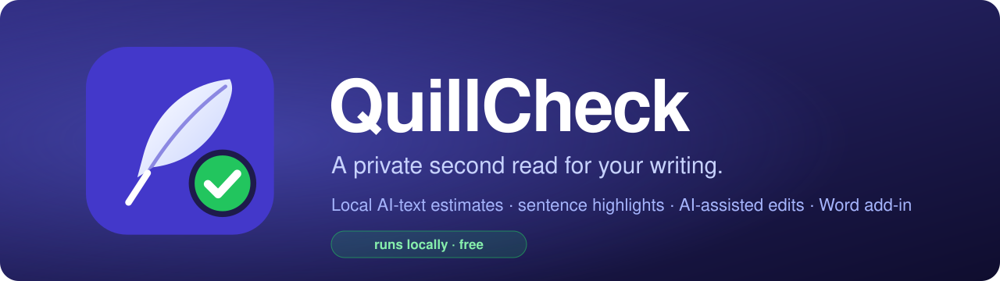
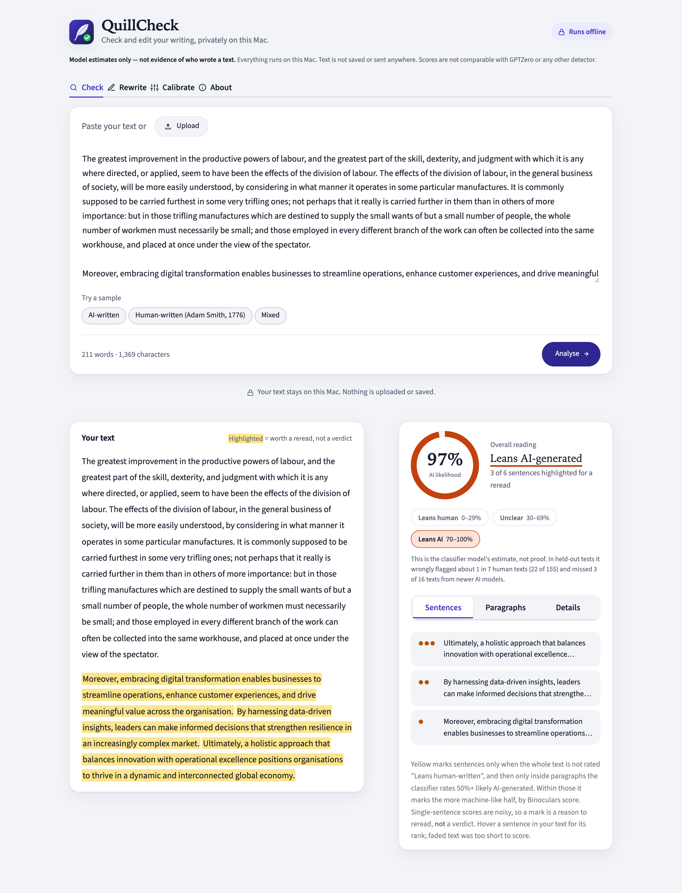
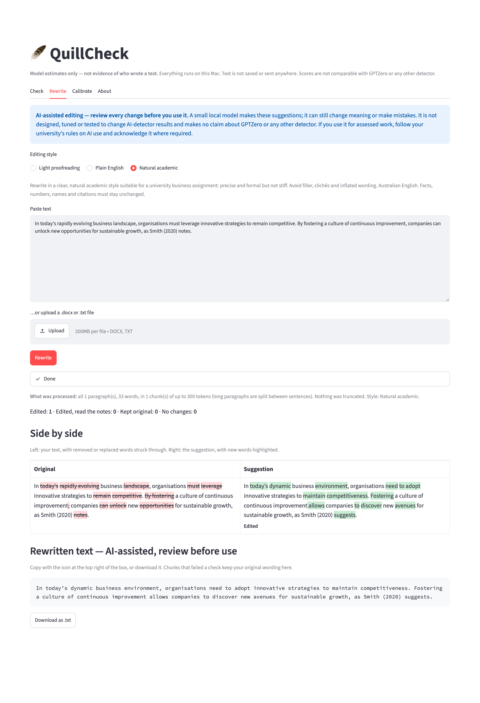
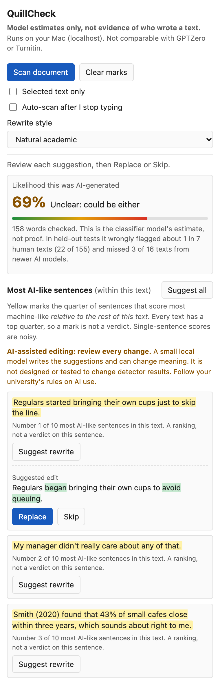

<div align="center">



### Check your writing for AI-sounding passages and tidy them up. The checking runs on your own computer, and QuillCheck never sends your text anywhere.

<a href="LICENSE"></a>


<a href="https://github.com/Daniil15DDD/quillcheck/stargazers"></a>

**[Quick start](#quick-start) · [Features](#features) · [Word add-in](#word-add-in) · [How it works](#how-it-works) · [FAQ](#faq) · [Validation](VALIDATION.md)**

<code>git clone https://github.com/Daniil15DDD/quillcheck && cd quillcheck && ./setup.sh && ./run.sh</code>

</div>

<br>

<p align="center">
  
</p>

> [!IMPORTANT]
> **Estimates, not evidence.** QuillCheck tells you which parts of *your* text read most like machine writing, so you can look at them again. It can be wrong in both directions, its scores are not comparable with GPTZero or Turnitin, and it is not built to beat any detector. If you use it for assessed work, follow your institution's rules on AI use.

## Why QuillCheck

| | Online AI checkers | **QuillCheck** |
| :--- | :--- | :--- |
| Where your text goes | Uploaded to someone's server | **Stays on your computer** |
| Cost | Free tier, then a subscription | **Free, no account** |
| Works offline | No | **Yes** for the app, after a one-time model download. The Word panel needs internet because Word loads Microsoft's `office.js` |
| Shows *which* sentences | Sometimes | **Yes**, ranked within your text |
| Helps you fix them | Usually not | **Yes**, local edit suggestions with a word-level diff |
| Inside Word | Rarely | **Yes**, side panel for Word on Mac and on the web |
| Open about its limits | Rarely | **Yes**, see [VALIDATION.md](VALIDATION.md) |

## Features

<table>
<tr>
<td width="33%" valign="top">

### 🔍 Check
An overall estimate from two independent local models, the most machine-like sentences highlighted *relative to the rest of your text*, and a per-paragraph breakdown. Paste text or upload a `.docx`/`.txt`.

</td>
<td width="33%" valign="top">

### ✍️ Rewrite
Suggestions in three styles: **light proofreading**, **plain English** and **natural academic** (Australian English). Every change is shown as a diff. Numbers, citations and links are checked, so they can't silently disappear or be invented.

</td>
<td width="33%" valign="top">

### 🎯 Calibrate
Add a few samples of your own past writing and QuillCheck compares new texts against *your* baseline instead of a generic threshold. Only scores are saved, never your text.

</td>
</tr>
</table>

<p align="center">
  
</p>

## Word add-in

<table>
<tr>
<td width="40%" valign="top">
  
</td>
<td valign="top">

Use QuillCheck **while you write** in Microsoft Word (Mac desktop or Word on the web):

- **Scan document** marks the most machine-like sentences in yellow, right in your document.
- **Suggest rewrite** shows an edit with a word-level diff. Click **Replace** or **Skip**.
- **Auto-scan** re-checks a few seconds after you stop typing.
- **Selected text only** checks just the part you're working on.
- **Clear marks** removes every highlight and leaves your words alone.

The panel sends your text only to the QuillCheck server on your own computer (`localhost`). Two things to know:

- When the panel opens, Word downloads Microsoft's `office.js` from the web, as it does for every Word add-in. So the panel needs an internet connection. Your text isn't sent there.
- With Word on the web, your document is stored in Microsoft's cloud as usual. QuillCheck only adds local checking.

**[Set up the Word add-in →](addin/README.md)**

</td>
</tr>
</table>

## Quick start

**You need:** an Apple Silicon Mac (tested on M4, 16 GB) or a PC with a CUDA GPU, about 8 GB of free disk space, and Python 3.12 ([uv](https://docs.astral.sh/uv/) recommended). It also runs on CPU only, but a check can take minutes.

```bash
git clone https://github.com/Daniil15DDD/quillcheck
cd quillcheck
./setup.sh     # one time: creates .venv, installs packages, downloads the models (~7.5 GB)
./run.sh       # then open http://127.0.0.1:8502
```

Setup is the only time the app needs the internet. `setup.sh` downloads the models, and the Word add-in's one-time certificate step (`npx office-addin-dev-certs install`) downloads Microsoft's certificate tool. After that, the app runs with Hugging Face offline mode forced on, can only load models already on your computer, and only listens on your own machine.

## How it works

```
your text ──► Binoculars (Qwen2.5-1.5B base + instruct) ──┐
         └──► desklib DeBERTa-v3 classifier ───────────────┼──► overall estimate + sentence ranking
                                                           │
flagged sentence ──► Qwen2.5-1.5B-Instruct (local) ──► safety checks ──► suggestion you accept or skip
```

- **[Binoculars](https://arxiv.org/abs/2401.12070)** compares how surprising your text is to two related language models. It's zero-shot, so no training data is needed.
- **desklib/ai-text-detector-v1.01** is a classifier trained on the RAID benchmark.
- Each model task runs in a short-lived process, so memory is handed back after every check (peak about 8 GB on an M4).
- The rewriter checks every suggestion against your original. If a number, citation or link is lost or added, your original wording is kept.

| Model | Used for | Licence |
|---|---|---|
| [Qwen/Qwen2.5-1.5B](https://huggingface.co/Qwen/Qwen2.5-1.5B) | Binoculars observer | Apache-2.0 |
| [Qwen/Qwen2.5-1.5B-Instruct](https://huggingface.co/Qwen/Qwen2.5-1.5B-Instruct) | Binoculars performer, Rewrite | Apache-2.0 |
| [desklib/ai-text-detector-v1.01](https://huggingface.co/desklib/ai-text-detector-v1.01) | Classifier | MIT |

## FAQ

<details>
<summary><strong>Will this get my text past GPTZero or Turnitin?</strong></summary>

No, and it isn't designed to. Those tools use different models, and QuillCheck's scores don't predict theirs. QuillCheck is for spotting stiff, generic passages in your own writing and making them clearer.
</details>

<details>
<summary><strong>How accurate is it?</strong></summary>

It's useful as a second opinion, not as proof. On held-out tests, the classifier wrongly flagged about 1 in 7 human texts, and Binoculars missed most passages from newer AI models. Formulaic writing (reports, frameworks), non-native English and famous older texts score as more machine-like. Full numbers are in [VALIDATION.md](VALIDATION.md).
</details>

<details>
<summary><strong>Why are some of my own sentences highlighted?</strong></summary>

Highlights are relative: every text has a "most machine-like quarter", even one written entirely by a person. A yellow sentence is a reason to reread it, not a verdict.
</details>

<details>
<summary><strong>Does it send my text anywhere or cost anything?</strong></summary>

QuillCheck never sends your text anywhere, and it costs nothing: no account, API key or subscription. The models run on your computer.

The Streamlit app was tested in a macOS sandbox that blocks the internet and logs every connection attempt. A full check and the full interface test suite made zero network attempts (see [VALIDATION.md](VALIDATION.md#2-offline-operation)).

The Word add-in server uses the same offline-locked model code, but it hasn't been through that sandbox test yet. The Word panel itself needs internet, because Word loads Microsoft's `office.js` when it opens.
</details>

<details>
<summary><strong>Does it work on Windows or Linux?</strong></summary>

The Python app should run anywhere PyTorch does (best with a CUDA GPU), but it has only been tested on macOS. The Word add-in also works with Word on the web.
</details>

## Project layout

```
app.py            Streamlit app (Check, Rewrite, Calibrate, About)
detector.py       Binoculars + classifier scoring
rewriter.py       Local editing model and its safety checks
worker.py         Runs each model task in a short-lived process
calibration.py    Personal calibration (scores only)
addin/            Word add-in (local HTTPS server + task pane)
desktop/          Optional macOS app wrapper (needs pywebview)
validation/       Test scripts and score-only results
```

## Licence

[MIT](LICENSE). The models are downloaded from Hugging Face under their own licences (see the table above) and are not included in this repository.
